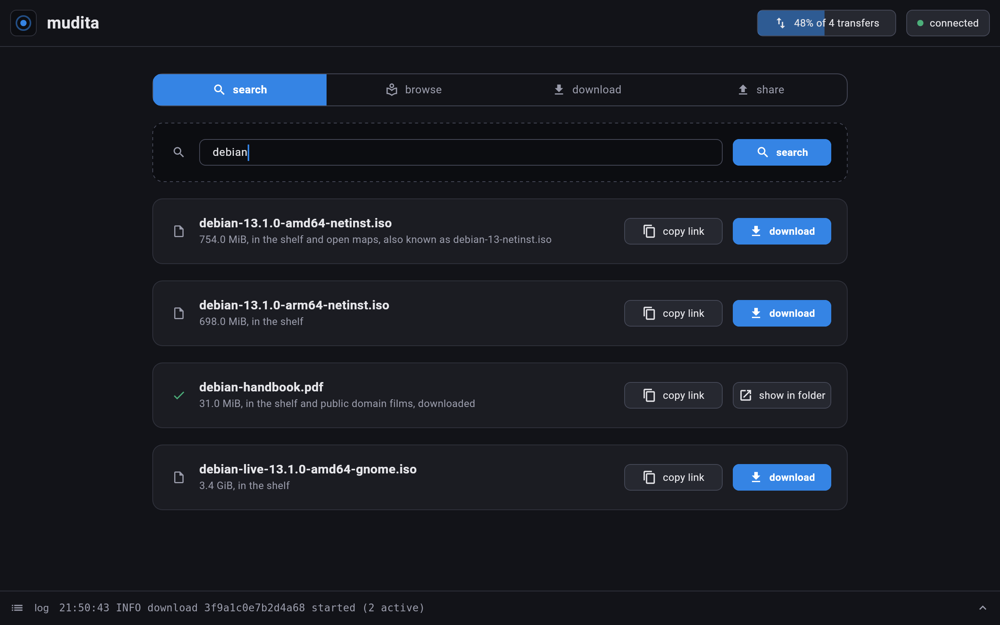
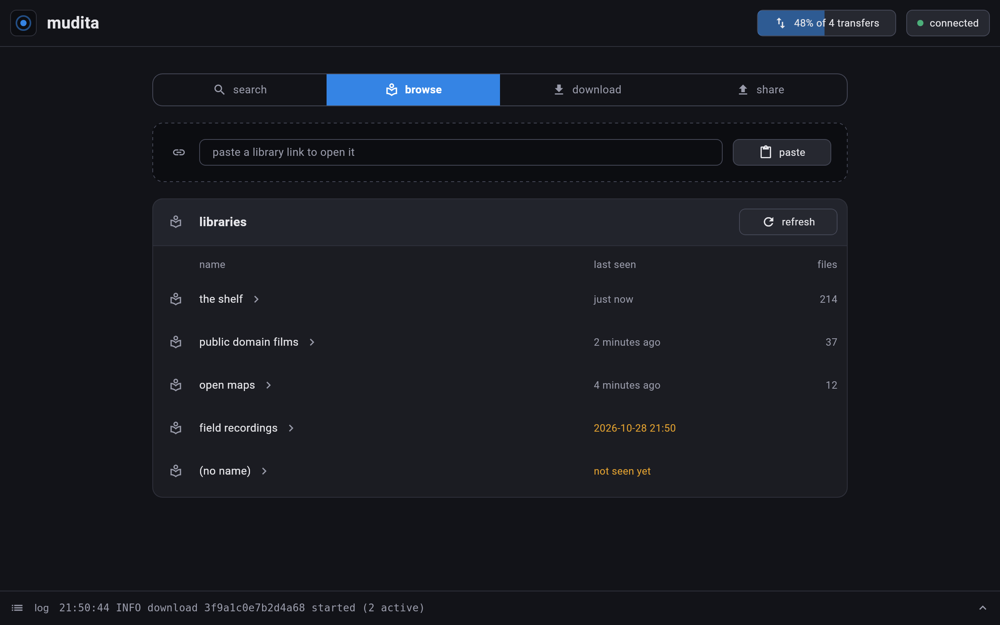
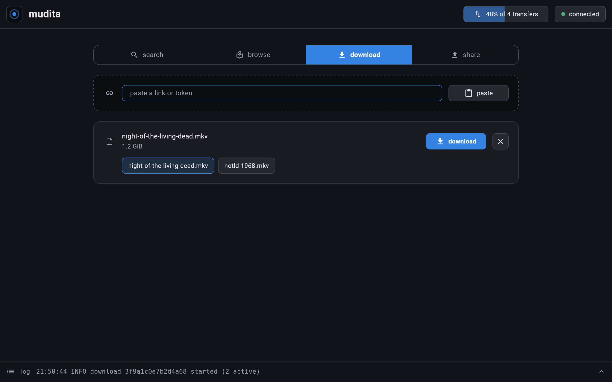
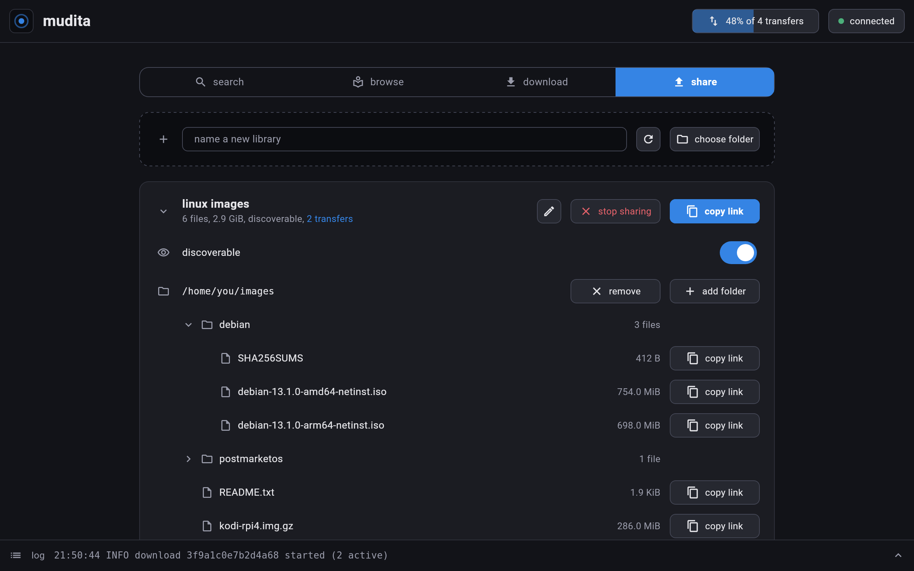
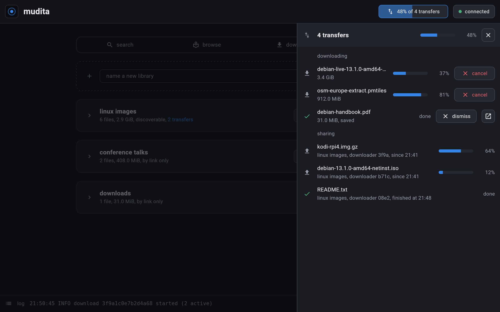

# mudita

send files directly between devices over the [veilid](https://veilid.com)
network from browser, desktop, or CLI.

pick a file, get a link, and anyone with the link downloads the file straight
from your device. nothing is uploaded anywhere: the file is available for as
long as someone who has it keeps mudita running. neither side learns the
other's ip address.

the share token in a link is made from the file's size and contents, and
the link carries its name besides. the same bytes shared again, on any
device and under any name, are the same file, and a download pulls from
everyone sharing it at once. the app also shares what it downloads, for as
long as the download stays open.

## screenshots

the library's window (see [the library](#the-library-dana) below), drawn
over a made-up library; `make screenshots` draws them again.

search across every library yours has discovered:



browse the libraries yours has discovered:



look up a pasted link before downloading it:



your own libraries, each a name over folders:



the transfers both ways, in a panel down the side:



## status

early development. up to 8 devices share a file at a time, from the command
line or the app. see [REQUIREMENTS.md](REQUIREMENTS.md) for the product
requirements.

## command line

```
mudita send <file>                         share a file until interrupted
mudita fetch <link-or-token> [-o <path>]   download a shared file
```

`send` prints the share token on stdout and logs the share link to stderr,
then serves the file until ctrl-c. running `send` on the same file somewhere
else prints the same token and joins in serving it. `fetch` takes either
one, downloads from every device sharing the file, verifies every piece, and
refuses to overwrite an existing file. `fetch` does not share what it
downloads.

everything else goes to stderr as log lines with a utc timestamp and a level.
while sharing, `send` logs each download as it starts and finishes:

```
2026-10-03T21:29:43.512345Z  INFO mudita::peer: download 3f9a1c0e7b2d4a68 started (1 active)
2026-10-03T21:30:25.803112Z  INFO mudita::peer: download 3f9a1c0e7b2d4a68 finished in 42s (150 pieces served in total)
```

the id is random per download and says nothing about who is downloading. a
download that fails or is abandoned never logs a finish. `fetch` logs its
progress at every 10 percent.

veilid's own logs are off by default; `RUST_LOG` turns them on, for example
`RUST_LOG=debug` for all of them or `RUST_LOG=net=debug` for one facility.

## app

one flutter codebase for web and linux, over the same core the command line
runs: in the browser the core is a wasm module in the page, and on linux it
is a `mudita serve` the app starts for itself. (android and ios are
scaffolded but have no core yet.) the web app is hosted at
http://veilid.tech/mudita. a switch at the top chooses between "download"
and "share", the same words the library window uses. to share, choose a file (or, in the browser, drop one on the
page) and copy its link; one file is shared at a time. to download, paste
a link or token, or open a share link: the file's name and size are shown,
and nothing is downloaded until you press download. a button in the top
bar says how many transfers are running and how far along they are, and
opens a panel down the side that lists them: your downloads, and the
people downloading from you. a link
to a whole library opens it to go through folder by folder, each file with
its own download button. received files stay in the panel until you dismiss
them, and a finished download keeps serving the file to others until you
dismiss it or close the app. a bar along the bottom shows the latest line of
the log and opens to show all of it, in the cli's words, newest first, each
line with its time and level:

```
14:30:25 INFO download 3f9a1c0e7b2d4a68 finished in 42s (150 pieces served in total)
14:29:43 INFO download 3f9a1c0e7b2d4a68 started (1 active)
```

## the library (dana)

mudita also has a library, called dana: the same network and the same links,
for whole folders instead of one file.

- share folders. every file in them gets a link of its own, which the
  one-file app and `mudita fetch` download like any other.
- set them out in as many libraries as you like: each a name you choose
  over one or more folders, with a link of its own. its link shows its own
  files under its own name, and nothing in it or about it points to your
  other libraries: there is no link, name or listing for all of them
  together. a new library is reached by its link alone; list it and
  searches find it too.
- browse what another library shares, or search file names across every
  library yours has discovered.
- download any number of files at once into `~/Downloads/mudita`, which is
  a library too, called "downloads".

your libraries are kept apart on the network, not hidden from it: all of
them go on and off line together, and whoever watches several of their
links for long enough can guess they are one person's. DESIGN.md ("a
node's libraries") says what is and is not kept apart.

the library is a server you leave running, and everything else is a remote
control for it:

```
mudita serve [--config <path>]          run the server until interrupted
mudita status                           what it shares, knows, and downloads
mudita search <words...>                search the libraries it has discovered
mudita download <number | link>         download a search result or a link
mudita rescan                           look for changes in the folders now
mudita uploads                          who is downloading from it, and how far
mudita browse <library-link>            list what another library shares
mudita library add <name> [--listed]    a new library, link-only unless listed
mudita library share <name> <folder>    share a folder in one
mudita library unshare <name> <folder>  stop sharing a folder of one
mudita library rename <name> <new>      call one something else; its link stays
mudita library list <name>              have searches find one
mudita library unlist <name>            have one reached by its link only
mudita library remove <name>            stop sharing one, and forget its link
```

`mudita status` prints each library with its link, which anyone can open
in the web app to see its folders and download from them. a link stays the
same across restarts and renamings.

its config is `~/.config/mudita/serve.json`, made on first run:

```
{
  "downloads": "/home/you/Downloads/mudita",
  "libraries": [
    {"name": "tunes", "folders": ["/home/you/music"], "listed": true},
    {"name": "downloads", "folders": ["/home/you/Downloads/mudita"], "listed": false}
  ]
}
```

a library whose entry leaves `"listed"` out is not listed.

a config from when a server had one library (`"folders": [...]`, maybe a
`"name"`) still works: it becomes one library with all those folders,
called what it was called or else what its first folder is, listed as it
was, and its link stays the same. what the link shows changes shape: files are no longer
under the name of the folder on disk they came from, so the contents of
two folders now sit side by side at the top. the download folder becomes a
library of its own. rename a library with `mudita library rename`, not by
editing the file: its link is kept under its name.

on linux desktop there is a window for it as well, which starts the server
when none is running and stops it again when closed; a server you started
yourself is left running. a switch at the top moves between its four
sides:

- search: type some of a file's name; each file found has a link to copy
  and a download button.
- browse: the libraries yours has discovered, each to go into folder by
  folder and download from; paste a library link to open one that is not
  listed.
- download: paste a file link or token to look a file up, and press
  download to fetch it. a library link pasted here opens on the browse
  side.
- share: your own libraries. name a new one and choose its folder; open
  one to rename it, make it discoverable or reachable by link only, add
  and remove folders, and copy the link of the library or of any file in
  it.

a button in the top bar says how many transfers are running and opens a
panel that lists them: your downloads, each with how far along it is, and a
finished one to show in its folder; and the people downloading from you.
the log is in a bar along the bottom, which opens to show all of it.

```
make run-dana     # run the window
make build-dana   # build it, with the server, into build/dana
```

there is no central index: each library asks the others it knows, and they
tell it who else they know. a file can be found only while a library sharing
it is running.

## build and run

toolchains are pinned with [mise](https://mise.jdx.dev). from the repo root:

```
mise install      # flutter, rust, and uv, as pinned in mise.toml
make              # build the cli and the web app (alias for `make build`)
make build-linux  # build the linux desktop app into build/bindu
make run          # run the app locally
```

the cli lands in `target/release/mudita` and the web app in `build/web`.
the first web build compiles the core, veilid included, to wasm, which takes
a few minutes.

to deploy the web app, copy the CONTENTS OF `build/web/` to the directory
served at `/mudita/`, `wasm/` and all. it is served over plain http, with no
special headers: a veilid node in a page cannot yet be used from https. a
page on plain http keeps a download in indexeddb until it is saved; on a
secure origin (https, or localhost) it uses the origin private file system,
which is what every deployment will use once veilid works over https. the
`web/` directory is the unbuilt template and does not work when served as
is. a different sub-path needs a rebuild with
`make build-web WEB_BASE_HREF=/other/`.

## tests

```
make test         # dart and rust unit tests (fast, hermetic)
make test-e2e     # real transfers between the cli and the web app
make precommit    # format check, static analysis, and unit tests
```

`make test-e2e` runs over the live veilid network, so it needs outbound
network access and an installed chrome.

see [CONTRIBUTING.md](CONTRIBUTING.md) for the developer workflow,
[DESIGN.md](DESIGN.md) for the protocol and architecture, and
[REFERENCES.md](REFERENCES.md) for related projects.
